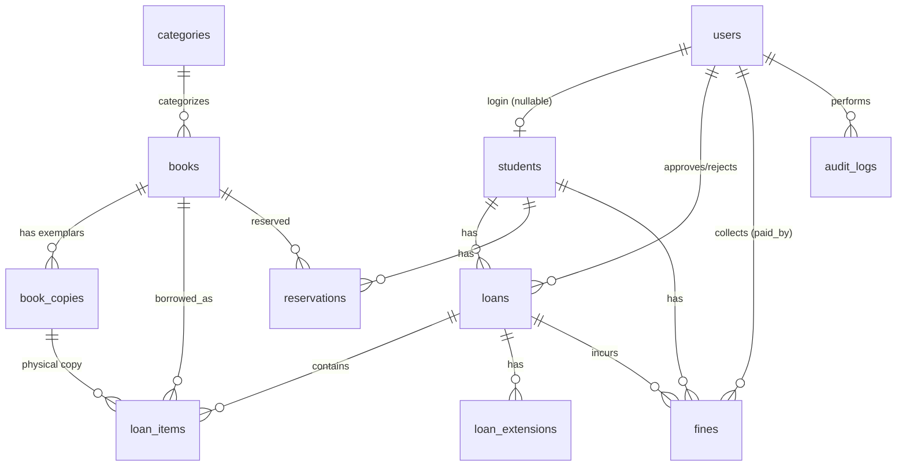

# AGENTS.md — Sistem Informasi Perpustakaan Sekolah (perpustakaan-skenda)

> Sumber kebenaran bisnis: `perpus.md` (53 bab). File ini merangkum keputusan desain yang
> mengikat agar setiap sesi/agent bekerja konsisten. Baca file ini + `perpus.md` sebelum coding.

## 1. Stack & Bahasa

- Laravel 13.26 (PHP `^8.3`), Filament `^5`, Livewire `^4`, SQLite (dev), PHPUnit.
- **Kode/database: Bahasa Inggris. UI/validasi/label enum: Bahasa Indonesia.**
- Conventions mengikat (§48 perpus.md): typed properties, return type, PHP Enum + `label()`,
  Eloquent + eager loading (no N+1), transaction di proses kritis, no raw SQL bila Eloquent cukup,
  no business logic besar di Filament Resource/Blade, no hardcoded role/denda/durasi,
  no `count()+1` untuk nomor transaksi.

## 2. Status Pengerjaan

- [x] Tahap 1 — Analisis (ringkasan di bawah)
- [x] Tahap 2 — Desain database (skema di bawah + ERD)
- [x] Tahap 4 — Migration, Model, Enum, Factory, Seeder
- [x] Tahap 5 — Auth & authorization (login email/username, role policies, panel guard, login audit)
- [x] Tahap 6 — Master data (Kategori, Buku+eksemplar, Anggota, Pengguna + guard anti-eskalasi role)
- [x] Tahap 7 — Peminjaman (LoanService+Extension, nomor anti-race, event/audit/notif, LoanResource)
- [x] Tahap 8 — Pengembalian & denda (ReturnService, FineService, scheduler overdue)
- [x] Tahap 9 — Reservasi (ReservationService + antrean)
- [x] Tahap 10 — Dashboard & laporan (widgets, export CSV/Excel)
- [x] Tahap 11 — Scheduler & notification (reminder H-3/H-1/H0, idempotent)
- [x] Tahap 12 — Testing (14 kasus §46 perpus.md)
- [x] Tahap 13 — Review (security, auth, integrity, race, N+1, idempotency)

## 3. Keputusan Arsitektur (mengikat, dari §40, §20, §5–§7 perpus.md)

1. **Model `books` + `book_copies`.** Barcode unik milik **eksemplar fisik**
   (`book_copies.barcode`, format `BK-000001`); tabel `books` TIDAK punya kolom barcode.
   `loan_items` mencatat `book_copy_id` (+ `book_id` untuk pelaporan).
2. **`books.available_stock` adalah cache**, bukan sumber kebenaran. Hanya boleh diubah lewat
   service stok terpusat dalam DB transaction + `lockForUpdate()`. Sumber kebenaran =
   status `book_copies` + `loan_items` aktif.
3. **Stok keluar saat status `BORROWED`** (buku fisik diserahkan), bukan saat request/scan.
   Stok kembali saat `RETURNED`. Pengembalian harus idempotent (double-click aman via cek
   status item, bukan sekadar `available_stock++`).
4. **`OVERDUE` dipersist** oleh scheduler (`due_at < now` + belum kembali), bukan murni derived,
   agar bisa di-query/index dan tidak bergantung pada user membuka halaman.
5. **Soft deletes**: `books`, `book_copies`, `students` (riwayat pinjaman/denda tidak boleh rusak).
   `loans`/`loan_items` tidak dihapus; `fines` me-restrict penghapusan loan/student.
6. **Kategori dihapus → `books.category_id = NULL`** (`nullOnDelete`; buku tanpa kategori tetap
   valid — keputusan §7). Jangan `restrict` yang memblokir operasional, jangan `cascade`.
7. **`students.user_id` nullable + `nullOnDelete`** — akun login boleh dihapus, baris siswa +
   riwayat tetap ada. Siswa `inactive`/`blocked` tidak bisa meminjam/memperpanjang (§8, §18).
8. **Denda menyimpan `amount` + `fine_rate_snapshot`** (tarif/hari saat dihitung) — kebal terhadap
   perubahan setting di tengah pinjaman aktif (§16).
9. **Nomor transaksi human-readable** (`PJ-YYYYMMDD-0001`, `RSV-YYYYMMDD-0001`) dibuat service
   khusus dengan transaction/locking. Dilarang `count()+1` (§27).
10. **Setting di tabel `settings` + cache** (`Setting::get()/set()`); dilarang query setting
    berulang per komponen (§26). Durasi/limit/denda default: `loan_duration_days=7`,
    `max_loans_per_student=3`, `max_extensions=1`, `extension_days=7`, `fine_per_day=1000`,
    `grace_period_days=0`, `max_fine=null`, `reservation_hold_days=3`.
11. **Gagal bayar bukan penghapus riwayat**: `fines.status` ∈ `unpaid/paid/waived`.
12. Satu siswa tidak boleh punya reservasi aktif ganda untuk buku yang sama, tidak boleh
    reservasi buku yang sedang ia pinjam, tidak boleh perpanjang buku yang direservasi orang
    lain (§52 — enforced di service, bukan DB partial index agar portable SQLite/MySQL).

## 4. Skema Database

```
users: id, name, email unique, username unique nullable, password, role='student',
       is_active=true, email_verified_at nullable, last_login_at nullable, timestamps
categories: id, name, slug unique, description nullable, timestamps
books: id, isbn nullable unique, title index, author, publisher nullable,
       publication_year nullable, category_id nullable→nullOnDelete,
       stock=0, available_stock=0, shelf_location nullable, cover nullable,
       description nullable, timestamps, softDeletes
book_copies: id, book_id→restrict, barcode unique, inventory_code nullable unique,
       status='available' index, condition nullable, shelf_location nullable,
       notes nullable, timestamps, softDeletes
students: id, user_id nullable unique→nullOnDelete, student_number unique (NIS),
       name, class index, major nullable, phone nullable, email nullable,
       address nullable, status='active' index, joined_at nullable,
       timestamps, softDeletes
loans: id, loan_number unique, student_id→restrict, status='pending' index,
       requested_at nullable, approved_at/borrowed_at/due_at(index)/returned_at nullable,
       approved_by/rejected_by nullable→users nullOnDelete, rejection_reason nullable,
       notes nullable, extension_count=0, timestamps
loan_items: id, loan_id→cascade, book_id→restrict, book_copy_id nullable→restrict,
       quantity=1, returned_quantity=0, due_at/returned_at nullable,
       status='pending' index, timestamps
loan_extensions: id, loan_id→cascade, requested_by→users nullOnDelete,
       old_due_at/new_due_at nullable, status='pending', approved_by nullable→users,
       reason nullable, timestamps
reservations: id, reservation_number unique, student_id→restrict, book_id→restrict,
       status='waiting' index, reserved_at/expires_at/fulfilled_at/cancelled_at nullable,
       queue_position=0, timestamps
fines: id, loan_id→restrict, student_id→restrict, amount=0, late_days=0,
       fine_rate_snapshot=0, status='unpaid' index, paid_at nullable,
       paid_by nullable→users, notes nullable, timestamps
settings: id, key unique, value nullable, timestamps
audit_logs: id, user_id nullable→nullOnDelete, action index,
       auditable_type nullable index, auditable_id nullable, old_values/new_values json nullable,
       ip_address nullable, user_agent nullable, timestamps (+index [auditable_type,auditable_id])
notifications: id uuid, type, notifiable morphs, data, read_at nullable, timestamps
```

Enum (semua punya `label()` Indonesia): `UserRole(student/staff/super_admin)`,
`StudentStatus(active/inactive/blocked)`, `LoanStatus(pending/approved/borrowed/
partially_returned/returned/rejected/overdue/cancelled)` + `canTransitionTo()` +
`isActive()`, `LoanItemStatus(pending/borrowed/returned/overdue/lost/damaged/cancelled)`,
`ReservationStatus(waiting/available/fulfilled/expired/cancelled)` + `isActive()`,
`FineStatus(unpaid/paid/waived)`, `BookCopyStatus(available/borrowed/reserved/lost/
damaged/maintenance)` + `isBorrowable()`, `ExtensionStatus(pending/approved/rejected)`.

### ERD



## 5. Peta Service/Event/Policy Mendatang (Tahap 5–11, jangan dibuat sekarang)

Services: `LoanService`, `ReturnService`, `FineService`, `ReservationService`,
`BarcodeService`, `BookStockService`, `NotificationService` (+ `SettingsService`).
Events: `LoanRequested/Approved`, `BookBorrowed/Returned`, `LoanOverdue`,
`ReservationAvailable` → listener: notifikasi + audit. Scheduler: tandai overdue,
kirim reminder H-3/H-1/H0, expire reservasi + oper antrean — semua idempotent
(dedupe key per loan+hari / per reservation). Policies per model: siswa hanya miliknya
sendiri (query scope + policy, bukan sekadar sembunyikan menu).

## 6. Kredensial Development (password: `password`)

| Role        | Email                | Catatan                    |
|-------------|----------------------|----------------------------|
| Super Admin | superadmin@skenda.test | Akses penuh + pengaturan |
| Petugas     | staff@skenda.test    | Operasional harian         |
| Siswa       | siswa1@skenda.test … siswa3@skenda.test | NIS `2526001`…`2526003` |

Seed: `php artisan migrate:fresh --seed`. Jangan hardcode password production.

## 7. Perintah Penting

```bash
php artisan migrate:fresh --seed   # reset + seed dev
php artisan test                   # suite (bisnis §46 menyusul di Tahap 12)
php artisan schedule:run          # cek scheduler (Tahap 11)
```

## 8. Aturan untuk Agent (§51 perpus.md)

1. Cek struktur & versi sebelum mengubah; ikuti pola existing yang tidak bermasalah.
2. Jangan ganti arsitektur/keputusan §3 tanpa diskusi; konflik dengan existing → jelaskan dulu.
3. Package tambahan hanya bila perlu + kompatibel + terpelihara; jangan tebak API.
4. Migration baru tidak boleh merusak data existing; semua migration harus rollback-able.
5. Test Tahap 12 wajib lolos sebelum klaim selesai; edge cases §52 perpus.md jadi acuan.
